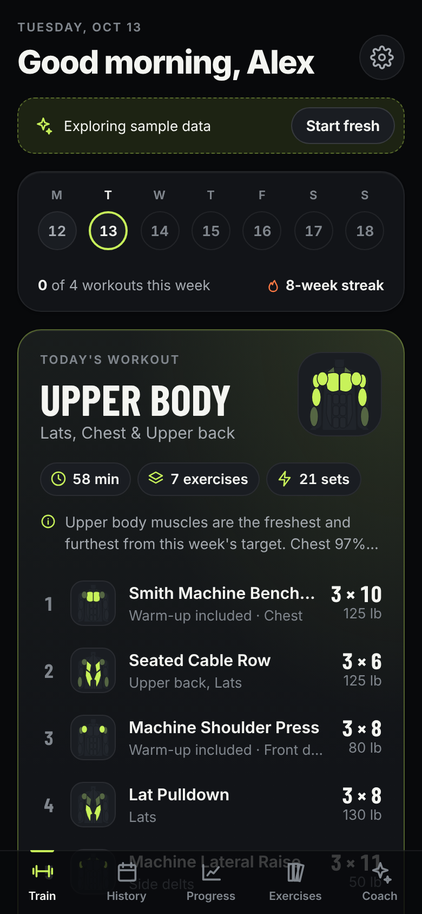
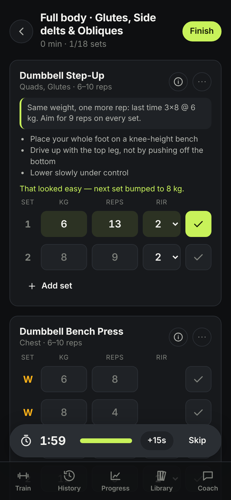
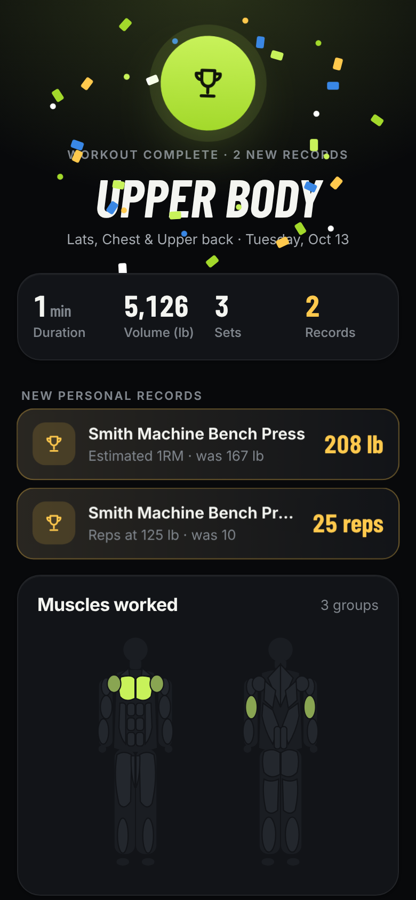
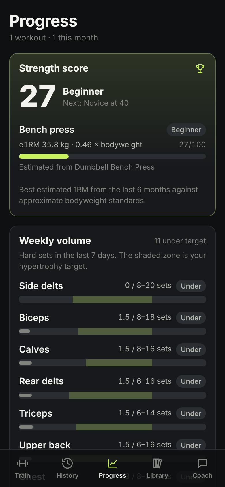
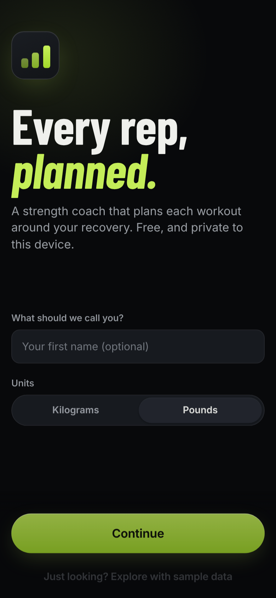
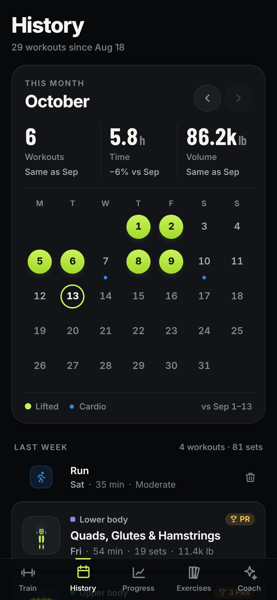
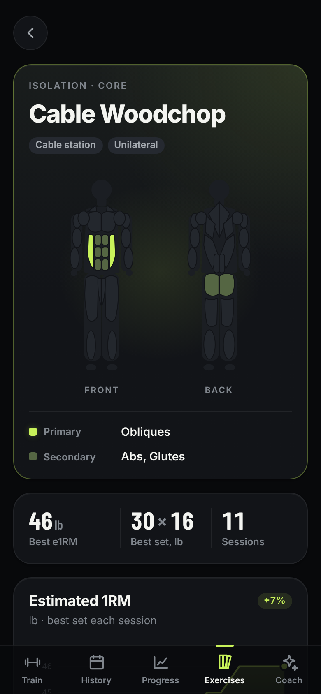
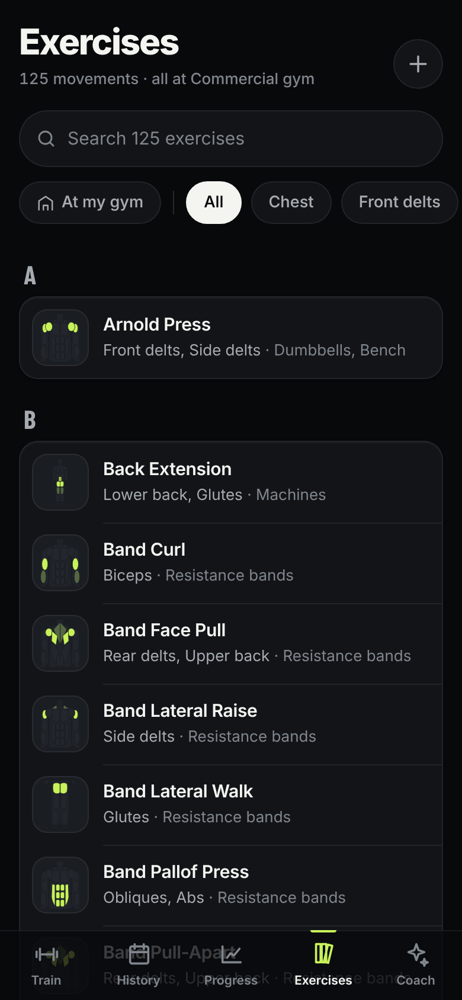

# Overload

**A free, open-source strength coach that plans every workout around how recovered you are, tells you exactly what to lift, and shows its math.**

Overload is inspired by AI-coached gym apps like Gravl, rebuilt in the open: no account, no subscription, works offline, and your training log never leaves your phone unless you export it. It's a static web app hosted free on GitHub Pages, with no backend.

**App:** https://fogz-lgtm.github.io/Overload/

<p>
  
  
  
  
</p>
<p>
  
  
  
  
</p>

## What it does

- **Builds today's workout for you.** Picks a focus (full body, upper/lower or push/pull/legs, depending on how often you train) based on which muscles are freshest and furthest from this week's volume target. Then it fills the session with exercises your gym actually has, sized to the time you have.
- **Your split, your way.** Pick a preset (full body, upper/lower, push/pull/legs, PPL + upper/lower, push/pull/core, or a body-part split) or build your own rotation from any mix of days. Run it in order, picking up where you left off, or let the engine choose whichever day you're freshest for. Leave it on automatic and the split follows how many days a week you train.
- **Tells you what to lift, and why.** Every exercise comes with a target weight, reps and reps-in-reserve plus a plain-English reason ("You hit 3×10 @ 80 kg with ~2 in reserve, so +2.5 kg"). Tap ⓘ to read it.
- **Adjusts mid-workout.** If a set was far easier or harder than prescribed, the remaining sets re-target automatically.
- **Shows you how.** Every exercise has a short form-demo video, on its page, in the workout preview and one tap from the logger. Prefer a different coach? Paste any YouTube link to swap it, or add one to your custom exercises. Videos play in YouTube's privacy-enhanced mode and only load when you press play; the thumbnails come from YouTube's image server.
- **Tracks muscle recovery.** An 18-muscle body map shows residual fatigue from lifting *and* from runs, rides, hikes and sport, so leg day doesn't land the morning after a hard trail run.
- **Progress you can trust.** Strength score against bodyweight standards, estimated 1RM trends per lift, weekly hard sets per muscle against target ranges, and automatic PR detection.
- **Works anywhere you train.** Save multiple gyms (home, commercial, hotel, bodyweight) with their equipment and switch with a tap. Includes 125 exercises plus your own custom ones, with swaps that hit the same muscles.
- **Your data is yours.** Stored locally in IndexedDB. One-tap JSON backup/restore, CSV export, and **import from Strong or Hevy** so you keep your history.
- **Optional AI coach.** Bring your own Anthropic API key to chat with a coach that sees your logs. It can build a workout from "30 minutes, hotel gym, my shoulder's sore", diagnose a stalled lift from its history, and log a run you mention. Everything else works without it.
- **Installable PWA.** Add it to your home screen; it works offline (form videos need a connection).
- **Try before you commit.** "Explore with sample data" plays a virtual lifter through eight weeks of the real engine so every screen is full on first launch, and "Start fresh" wipes it.
- **Built like a paid app.** A documented design system ([`docs/DESIGN.md`](docs/DESIGN.md)) covers dark and light themes, spring motion, haptics, and anatomy thumbnails on every exercise. Every screen passes axe-core accessibility checks in both themes.

## How the coach thinks

All of it lives in [`src/engine`](src/engine). It's pure TypeScript with no UI or storage dependencies and is covered by unit tests. Read it, tweak it, open a PR.

| Piece | Model |
|---|---|
| **Recovery** ([`recovery.ts`](src/engine/recovery.ts)) | Each hard set adds 1 fatigue unit to its primary muscles and 0.5 to secondaries, scaled by effort (closer to failure = more). Fatigue decays exponentially with a per-muscle half-life (≈16 h forearms → 30 h quads). Recovery % = 1 − fatigue ÷ capacity. Cardio adds leg fatigue by duration and intensity. |
| **Volume** ([`volume.ts`](src/engine/volume.ts), [`muscles.ts`](src/engine/muscles.ts)) | Weekly hard sets per muscle (primary 1, secondary ½) compared with a target range derived from published volume landmarks, scaled by goal (hypertrophy 100%, strength 70%, general 60%). |
| **Session planning** ([`generator.ts`](src/engine/generator.ts)) | Picks the focus whose muscles score highest on recovery and weekly deficit. Fills anchor slots with big compound patterns first (squat, hinge, push, pull), then accessories by muscle need until the time budget runs out. Exercise choice favors lifts you've been progressing on (continuity is what makes overload work), your favorites, and loadable movements. It avoids recovering, sore or excluded muscles and same-pattern duplicates. Deterministic per day with a re-roll seed. |
| **Progression** ([`progression.ts`](src/engine/progression.ts)) | Double progression with RIR autoregulation. Every set hits the top of the rep range at the target RIR → add the smallest practical increment (bigger for heavy squats and hinges). Inside the range → same weight, +1 rep. Far below → re-target from your estimated 1RM. No e1RM gain in 3 sessions → planned 10% deload. Back after 3+ weeks → ease in at 80–90%. The first session is seeded conservatively from bodyweight, or from a related lift you've already logged. |
| **Strength score** ([`analytics.ts`](src/engine/analytics.ts)) | Best e1RM (Epley, counting reps in reserve) for squat, bench, deadlift, overhead press and row, with dumbbell and variation equivalents, divided by bodyweight and mapped to a 0–100 scale through beginner→elite standards. |

## How this repo hosts the app

Every push to `main` runs `.github/workflows/deploy-pages.yml`. The workflow runs the tests, typechecks, builds the app into `dist/` for the repo's Pages path, and publishes it to GitHub Pages. A service worker makes the installed app open instantly from a local copy and work offline. When a new deploy lands it shows an "Update ready — tap to refresh" banner instead of reloading on its own, so it never interrupts a set.

One-time setup (repo owner, in Settings): make the repo **public** (free accounts can only use Pages on public repos), then go to **Settings → Pages → Source: "GitHub Actions"**. If the first workflow run failed before this was done, re-run it from the Actions tab.

On your phone, open the app in Safari and choose **Share → Add to Home Screen**.

## Develop

```bash
npm install
npm run dev        # http://localhost:5173
npm test           # engine, importer and coach-loop tests
npm run build      # static site in dist/
```

Requires Node 20+.

## Turn on the AI coach (optional)

In **Settings → AI coach**, paste an [Anthropic API key](https://console.anthropic.com/settings/keys) and pick a model (Claude Opus 5.5 by default; Sonnet 5.5 and Haiku 5.5 are cheaper). The key is stored only in your browser and is sent only to `api.anthropic.com`. Requests go directly from your device to the API; there's no Overload server. Each message includes a compact snapshot of your training data so the coach can ground its answers. Opus and Sonnet requests opt into the API's server-side fallback, so a rare declined request is retried on a fallback model instead of failing.

## Project layout

```
src/
  engine/      Pure training logic + tests (recovery, progression, generator, analytics, sample-data simulator, CSV importers, exercise library and form videos)
  db/          Dexie (IndexedDB) schema, queries, backup/restore and CSV import
  ai/          Optional Claude coach: training snapshot, tools, streaming tool loop
  pages/       Screens (Train, Workout, Summary, History, Progress, Library, Coach, Settings, Onboarding) + per-screen CSS
  components/  Body map / muscle thumbnails, chart, sheet, exercise pickers, inputs, icons
  ui/          Design-system pieces: ring, count-up, sparkline, toast, confirm sheet, week strip, plate stack
docs/DESIGN.md Design system: principles, tokens, components, writing
```

## Roadmap ideas

- Apple Health / Health Connect and Strava import for cardio
- Supersets and circuits
- Multi-week blocks with planned deload weeks
- Optional self-hosted sync between devices

Contributions welcome. Keep the engine pure and tested, and keep the UI fast on a phone.

## License

MIT
